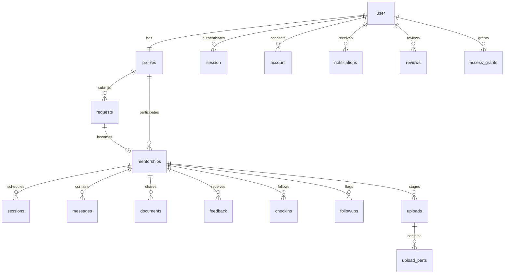

# Database

All SETU tables live in the private PostgreSQL schema `setu`. Hosted Supabase supplies PostgreSQL. Better Auth owns authentication tables; SETU owns programme tables. The application does not use Supabase Auth or expose these tables to browser clients.

The application migration is [001-core.sql](../database/001-core.sql). [migrate.ts](../scripts/migrate.ts) also generates Better Auth tables from the installed configuration.

## Relationships

`session` is a Better Auth login session. `sessions` stores mentorship appointments. They are different tables with different retention rules.

## Authentication tables

Better Auth creates and migrates the following tables. Exact generated columns follow the installed package version, so use its migration runner when upgrading it.

| Table          | Data                                                                                           |
| -------------- | ---------------------------------------------------------------------------------------------- |
| `user`         | ID, Google name and email, verified-email flag, timestamps, image, and server-controlled role. |
| `session`      | Persistent login token, user reference, expiration, and request metadata.                      |
| `account`      | Google provider account linkage and provider token fields.                                     |
| `verification` | Temporary verification records. Google OAuth state uses an encrypted browser cookie.           |
| `rateLimit`    | Shared authentication rate-limit counters.                                                     |

Application roles are `student`, `mentor`, and `admin`. Programme eligibility lives in `profiles.verification`, independently of Google email verification.

Google OAuth state expires after ten minutes and is consumed from its HttpOnly browser cookie. Successful callbacks still persist users, accounts and seven-day sessions in PostgreSQL. The state-storage configuration does not change table definitions or require a SQL migration.

## Programme tables

| Table               | Key and references                                                                 | Stored data                                                                                                                                                                                       |
| ------------------- | ---------------------------------------------------------------------------------- | ------------------------------------------------------------------------------------------------------------------------------------------------------------------------------------------------- |
| `profiles`          | `user_id` primary key references `user`, cascading on user deletion.               | Name, roll number, bio, interests, skills, career path, contact details, graduation year, organization, experience, consent, eligibility state, reason, availability, and submission/update time. |
| `requests`          | UUID primary key, `student_id` references `profiles`.                              | Career goal, uncertainty, areas, timeline, submitted/matched/closed status, close reason, and creation time.                                                                                      |
| `mentorships`       | UUID primary key, unique request reference, student and mentor profile references. | Active/ended status, start/end timestamps, ending actor, category, and reason.                                                                                                                    |
| `sessions`          | UUID primary key, mentorship reference.                                            | Title, start time, duration, meeting URL, scheduled/held/cancelled/missed status, reminder flag, and creation time.                                                                               |
| `messages`          | UUID primary key, mentorship and sender references.                                | Text body and creation time.                                                                                                                                                                      |
| `documents`         | UUID primary key, mentorship and uploader references.                              | Sanitized filename, validated MIME type, size, `bytea` content, and creation time.                                                                                                                |
| `feedback`          | Composite key of mentorship and author.                                            | Rating, goal status, comment, support-needed flag, and creation time.                                                                                                                             |
| `checkins`          | UUID primary key, mentorship and student references, unique mentorship/round.      | Round, due time, pending/answered/no-response status, goal status, and comment.                                                                                                                   |
| `notifications`     | UUID primary key and recipient reference.                                          | Body, read flag, creation time, email completion time, attempt count, and next retry time.                                                                                                        |
| `reviews`           | UUID primary key, applicant and reviewer user references.                          | Eligibility decision, reason, and timestamp.                                                                                                                                                      |
| `followups`         | UUID primary key, mentorship reference, unique mentorship/kind.                    | Conduct or support category, administrator note, and resolved flag.                                                                                                                               |
| `access_log`        | Generated bigint identity.                                                         | Optional user ID, rejected action name, HTTP status, and timestamp.                                                                                                                               |
| `uploads`           | Client-generated UUID primary key, mentorship and uploader references.             | Original filename, total size, part count, and creation time.                                                                                                                                     |
| `upload_parts`      | Composite key of upload ID and part index. Upload reference cascades on deletion.  | One chunk's `bytea` content.                                                                                                                                                                      |
| `access_grants`     | Lowercase email primary key, granting admin user reference.                        | Student/mentor role, reason, grant time, and optional revocation time.                                                                                                                            |
| `schema_migrations` | Migration filename primary key.                                                    | SHA-256 checksum and application time. Created by the migration runner.                                                                                                                           |

`local_mail` is an optional development-only table with recipient, subject, body, and timestamp. It is created only when migration runs outside production with `LOCAL_EMAIL_CAPTURE=true`. It is not part of hosted production setup.

Programme UUIDs use `gen_random_uuid()`. Auth user IDs are text because Better Auth owns their format. All programme timestamps use `timestamptz`; session input includes a UTC offset. The UI formats time in the user's browser timezone.

## Constraints

| Constraint                     | Enforcement                                                               |
| ------------------------------ | ------------------------------------------------------------------------- |
| One open student request       | Partial unique index on `requests.student_id` where status is not closed. |
| One active pairing per student | Partial unique index on `mentorships.student_id` where status is active.  |
| One active pairing per mentor  | Partial unique index on `mentorships.mentor_id` where status is active.   |
| One pairing per request        | Unique `mentorships.request_id`.                                          |
| Valid ending state             | An active mentorship has no end timestamp; an ended mentorship has one.   |
| Distinct participants          | Student and mentor IDs cannot be equal.                                   |
| Session duration               | SQL check allows 30, 45, 60, or 90 minutes.                               |
| Message size                   | SQL check requires 1 to 2000 characters.                                  |
| Document size                  | SQL check requires 1 byte to 5 MiB.                                       |
| Feedback                       | Unique author per mentorship, rating 1 to 5, known goal status.           |
| Check-in rounds                | Round 1 or 2, unique per mentorship.                                      |
| Upload shape                   | One to five parts, indexes zero to four, each part at most 1 MiB.         |
| Account grants                 | Lowercase email and student/mentor role only.                             |

Zod validates request text, URL formats, consent, enums, and field lengths before mutation. Transaction locks enforce rules that SQL row checks cannot express alone, such as ten counted sessions, no overlap, twenty documents, and approved participants. Read [BACKEND.md](BACKEND.md) for lock ordering and permission checks.

## Indexes

The schema indexes programme lookups by mentorship, participant, status, and time.

- `requests_status_created` supports request queues.
- `mentorships_student_created` and `mentorships_mentor_created` support participant history.
- `sessions_mentorship` and `documents_mentorship` support shared-space lookups.
- `messages_mentorship` indexes conversation order.
- `profiles_verification_submitted` supports review queues.
- `notifications_user` supports recipient history.
- `notifications_email_queue` is partial over unsent notices below ten attempts.
- `uploads_created` supports incomplete-upload cleanup.

The unique indexes described above also enforce concurrency constraints. Additional indexing should follow observed query plans and workload, not assumed traffic.

## Migration ownership

The runner uses a session advisory lock while it creates the schema and runs Better Auth migration generation. It then applies application SQL files in filename order inside a transaction and records their checksums.

Application migrations match `NNN-name.sql`. Add `002-description.sql` for the next change. An applied file with a changed checksum causes the runner to fail instead of silently rewriting migration history. Better Auth migrations are a separate phase before the application transaction. Do not assume both phases roll back as one unit.

`MIGRATION_DATABASE_URL`, when set, overrides `DATABASE_URL` for the runner. Use a direct or session-pooler URI because session advisory locks cannot safely use a transaction pooler. The runner rejects port 6543 before connecting. It also rejects a hosted migration target when the runtime target is loopback. Clear inherited `MIGRATION_DATABASE_URL` for local tests. Runtime SQL fully qualifies `setu` tables rather than relying on connection search paths.

## Supabase isolation and permissions

Migration enables RLS on every table in `setu` and revokes schema and table privileges from Supabase's `anon` and `authenticated` roles. It creates no browser RLS policies because there is no browser database client. Keep `setu` unexposed in Data API settings.

The application uses a privileged server connection. Programme authorization is enforced in the server service, not through `auth.uid()` policies. RLS blocks ordinary unprivileged access but does not constrain the owner or a bypass-RLS server role. A future change to browser access requires a separate permission and policy design.

The app does not create functions, views, or storage buckets. Supabase Auth's tables and the Realtime schema remain outside SETU migration ownership.

## Data lifecycle

Private messages and documents become inaccessible 30 days after ending. Maintenance physically deletes them after that deadline. Upload parts cascade away when a completed or abandoned upload is removed. Security logs expire after 90 days. Programme profiles, reviews, requests, mentorships, feedback, and check-ins have no automatic retention deletion in this release.

Most programme foreign keys do not cascade on user deletion. Removing an account with programme history therefore requires a reviewed deletion process. There is no automated deletion command or self-service deletion screen.

Documents are currently stored in PostgreSQL. That keeps small private file writes transactional, but increases database size, backup cost, and server memory use. A future object-storage migration needs equivalent private access checks, cleanup guarantees, and metadata consistency. See [SYSTEM.md](SYSTEM.md) for the current scale boundaries.

Every mentor needs an unrevoked `access_grants` row. Explicit administrator rules take precedence. An active grant can admit an alumnus using a student-domain email as a mentor. Without a grant, student-domain admission applies. Existing account roles cannot be changed through whitelisting. No schema migration is needed for the role-theme and session-configuration pass. `bun run db:check` reads table presence and auth schema without modifying data.
