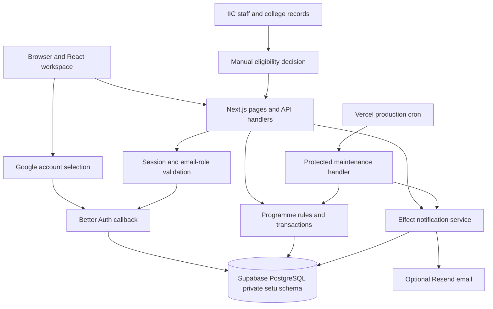
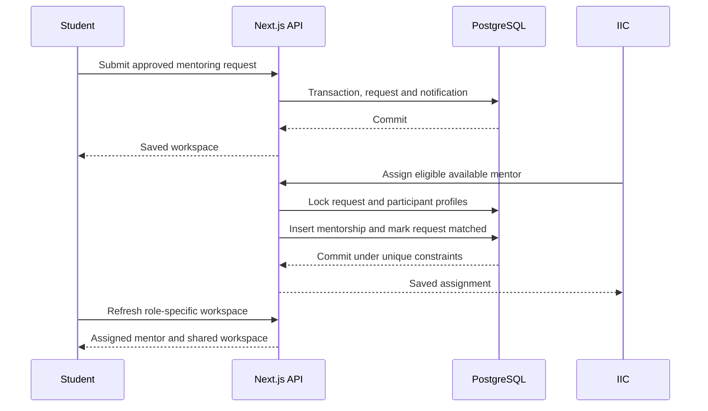

# System design

SETU is one Next.js application with a private PostgreSQL database and a small number of external integrations. The landing, About and policy content is prerendered. Client components add GSAP artwork, guidance controls and a shared curtain menu. Public navigation uses Next.js links and native scrolling; it does not call the programme API. Authenticated pages check identity on the server. A client boot component shows skeletons and fetches a protected snapshot. View selection uses native history immediately; background API requests refresh data afterward.

Public motion includes GSAP disclosures, a Canvas isometric height surface, local ASCII hand assets and a lazily initialized WebGL logo ripple. These effects remain in the browser and suspend offscreen. React route transitions use the browser View Transitions API; workspace section changes retain their existing immediate navigation.

## Boundaries

The browser never receives a PostgreSQL credential or talks directly to Supabase. Supabase supplies the hosted database; Better Auth supplies identity and sessions. College records remain outside SETU's system boundary because there is no portal API integration.

The implemented boundaries map to these sources.

| Boundary                           | Source                                                                                                                                    |
| ---------------------------------- | ----------------------------------------------------------------------------------------------------------------------------------------- |
| Browser workspace and mutations    | [WorkspaceApp](../src/components/workspace.tsx).                                                                                          |
| Protected HTTP handlers            | [workspace API](../src/app/api/workspace/route.ts) and [HTTP boundary](../src/lib/http.ts).                                               |
| Google identity and current access | [identity and getAuth](../src/lib/auth.ts), [resolveEmailRole](../src/lib/access.ts).                                                     |
| Programme state and transactions   | [performAction and getWorkspace](../src/lib/workspace.ts), [Database](../src/lib/db.ts).                                                  |
| Chunked private documents          | [uploadChunk](../src/lib/uploads.ts) and [download route](../src/app/api/documents/[id]/route.ts).                                        |
| Delivery and maintenance           | [NotificationDelivery](../src/lib/notifications.ts), [cron handler](../src/app/api/cron/route.ts), and [Vercel schedule](../vercel.json). |

## Identity and programme access

Google verifies the email. SETU assigns a permitted role from server configuration or an active IIC account grant. Account identity and programme approval are separate states. A student can sign in with an eligible Google account and still wait for IIC to confirm degree-level status.

Google sign-in starts on the configured application origin. Better Auth stores encrypted, ten-minute state in a browser cookie and validates it with PKCE before exchanging the callback code. Missing or mismatched browser state is rejected before session creation. Local tests exercise this path with mocked provider responses; a live Google round trip still requires deployment verification.

Every protected request checks the session, verified email, and current role allowance. Every programme operation then checks eligibility, ownership, and the operation's state rules. An administrator's broad programme access does not include private messages, documents, or detailed session records.

Mentors always require active grants. Sessions use persistent seven-day cookies, renewed at most daily during active use. This separation lets IIC grant mentor invitations and student exceptions without claiming that an email whitelist proves institutional eligibility. It also lets access revocation block later requests without waiting for an old session to expire.

## Request and assignment flow

The database supplies the concurrency guarantee. Partial unique indexes prevent duplicate active pairings even if two administrators submit at once. Service checks provide useful errors before those indexes reject an invalid write.

## Persistence and consistency

Domain mutations and their in-app notifications commit together. A saved response means the database accepted the mutation. The browser then refreshes its snapshot. Other browsers refresh every 30 seconds while visible and on focus. Navigation refreshes are abortable and superseded results cannot replace a newer snapshot. Loading an already selected view never waits on those requests.

The snapshot queries run independently in parallel. They are not one repeatable-read transaction, so a refresh during another write can briefly include records from different commit times. Actions re-read the records they lock before mutation. The initial release accepts this display behavior; stronger snapshot consistency can be added if it becomes necessary.

Each Next.js process reuses one bounded `pg` pool. Effect manages query failures and transaction finalizers. Transactions remain uninterruptible while `pg` owns their client. Database statement and idle-transaction timeouts bound stuck work.

## Private documents

A browser sends a file in sequential 1 MiB multipart chunks. PostgreSQL stores staging metadata and parts. Completion validates ownership, total size, extension, and signature, then inserts a single private document and deletes its staged upload in one transaction.

This supports files up to 5 MiB without sending a full 5 MiB request through a Vercel function. Downloads stream 64 KiB chunks, although the current service first loads the complete document into server memory. Download authorization always checks pair membership and the archive deadline.

Database storage keeps file metadata and content transactional for this release. It is a deliberate initial limit. Larger files or high volume should move to private object storage with signed access and an explicit cleanup process.

## Notifications and maintenance

Notification email delivery is separate from the transaction that saves programme state. Next.js `after()` attempts a flush after responding. A production cron job also flushes pending notifications after maintenance.

The queue lives in PostgreSQL. Atomic row leases and `SKIP LOCKED` prevent concurrent workers from claiming the same ready batch. Provider idempotency keys reduce duplicate deliveries if a provider accepts an email before the database records completion. This is retryable delivery, not a claim of exactly-once delivery.

The default cron runs once daily at 03:00 UTC. Maintenance uses a transaction advisory lock to serialize overlapping invocations. It updates elapsed-session state, applies completion and retention rules, expires check-ins, and queues session reminders.

Time-sensitive effects can lag until the next successful invocation. A newly created session inside the next daily run's reminder window may not receive a timely reminder. Read permissions still enforce the 30-day content cutoff immediately. Use a shorter authenticated schedule when programme needs or volume require it.

## Deployment model

Vercel serves the Next.js application. Hosted Supabase stores all persistent accounts and data. Google Cloud holds the OAuth client. Optional Resend sends programme notifications. Bun installs dependencies and runs project scripts; production route handlers use the Node.js runtime.

Builds do not migrate the database. A trusted operator runs migrations before authenticated traffic uses a changed schema. Use separate preview databases for unreviewed schema changes or fixtures. Keep production OAuth callbacks and secrets scoped to the production origin.

Static public pages can use Vercel's normal caching. Workspace responses and private attachments are no-store. Do not introduce shared caching for authenticated snapshots without including identity and permission state in the design.

## Current scaling limits

| Area                | Present boundary                                                                                                                              | Next change when required                                                 |
| ------------------- | --------------------------------------------------------------------------------------------------------------------------------------------- | ------------------------------------------------------------------------- |
| Connection pools    | Five connections per process by default, configurable from 1 to 20.                                                                           | Budget total instance connections against Supabase pooler limits.         |
| Workspace snapshots | Most programme/admin lists cap at 500 rows; notification history caps at 100; messages cap at 200. Some feedback/check-in lists are uncapped. | Server pagination, smaller per-screen queries, and aggregated reporting.  |
| Analytics           | Counts derive from the loaded snapshot.                                                                                                       | Database aggregates over the full programme.                              |
| Chat                | Thirty-second polling and focus refresh.                                                                                                      | Authenticated subscriptions if programme use needs them.                  |
| Files               | Twenty documents per mentorship, 5 MiB each, stored in PostgreSQL.                                                                            | Private object storage and direct upload orchestration.                   |
| Email               | Twenty notices per flush, three concurrent deliveries, ten attempts.                                                                          | Dedicated scheduled worker and queue monitoring.                          |
| Maintenance         | One transaction, daily schedule, 60-second route budget.                                                                                      | Batched jobs and a shorter compatible schedule.                           |
| Anti-abuse          | Auth rate limit and programme/file limits.                                                                                                    | Application mutation throttling when operating beyond controlled cohorts. |

The code has concurrency protections and bounded resources. It has not undergone load testing, and the 500-row snapshot limits mean this release does not yet provide complete large-programme analytics. Scale decisions should follow observed query timings, payload sizes, queue age, and connection pressure.

## Operations and recovery

Monitor Vercel API and cron failures, Supabase connection usage, long queries, and the oldest unemailed notification. Failed provider delivery leaves notices available in-app. Failed mutations roll back their database transaction and return a safe message.

PostgreSQL remains the persistent source of programme state. Supabase backup availability depends on the project's plan and settings. Backup restoration and disaster recovery have not been exercised for SETU. Review backup coverage before using it for an institutional programme.

The public policy pages state current access and retention behavior. Official support contacts, institutional policy review, final domain confirmation, real Google callback verification, and email delivery verification remain deployment/programme configuration work.

The hosted schema migration and private permissions were checked against the supplied Supabase connection. Google initiation succeeded. Full Google login, Vercel deployment, deployed cron execution, email delivery, and recovery remain unverified external behavior.

Read [BACKEND.md](BACKEND.md) for services and contracts, [DATABASE.md](DATABASE.md) for schema constraints, and [README.md](../README.md) for setup commands.
